# Aegis

A bench prototype of a **post-quantum attestation gateway**. A PolarFire SoC Discovery Kit decides
which endpoints may be trusted, from evidence their secure hardware produces, and gives admitted
endpoints a credential and an ML-KEM-768 session key. Identities and quotes are signed with
ML-DSA-65 (FIPS 204); key exchange uses ML-KEM-768 (FIPS 203).

What runs on the bench today:

- the PolarFire gateway signs its own quote and attests endpoints (`gateway/`), with a fabric
  Keccak/NTT accelerator (`hw/`) that passes the NIST ACVP vectors;
- an STM32H573I-DK (TF-M v2.3.0 plus a PQ partition) is attested over Ethernet and held in a
  session with heartbeats (`endpoints/stm32h573/`);
- an NXP FRDM-RW612 (Zephyr, ML-DSA-65 key derived in the chip's ELS from the die key) is attested,
  provisioned and held in a session the same way, labelled device-key trust (`endpoints/rw612/`);
- a tampered Non-Secure image, and an Arduino Uno that cannot attest, are quarantined;
- a red-team harness and a regression run (`tests/`, `tools/regression.sh`) that checks all of it.

One decision cycle, every 30 seconds per endpoint:

Read `docs/architecture.md` first, then `docs/threat-model.md` for what is **not** claimed. This is
a development prototype: development signing keys, trust-on-first-use enrolment, and no network
enforcement on a single-port gateway are stated limits.

## Running it

Copy `bench.env.example` to `bench.env` and set your addresses. Then:

    tools/setup_host.sh        # Python environment and liboqs
    tools/regression.sh        # host stages; add --board for the real boards
    tools/demo.sh              # the live demo (needs the boards and an STM32 programmer)
    sudo tests/host/test_enforcement.sh   # the enforcement rules in network namespaces

## Layout

`gateway/` services and policy, `common/` wire formats and crypto glue, `host/` PC tools,
`endpoints/` firmware for the prover nodes, `hw/` fabric RTL, `tests/`, `vectors/` (ACVP
checksums), `evidence/` (published records of real runs), `docs/` (architecture, threat model,
whitepaper, datasheet, phase notes, `diagrams/` generated by `tools/gen_diagrams.py`, `figures/`
Libero screenshots).

Apache-2.0 licensed (see `LICENSE`; source files carry SPDX headers). Not security-certified; do not use it to protect anything real.
