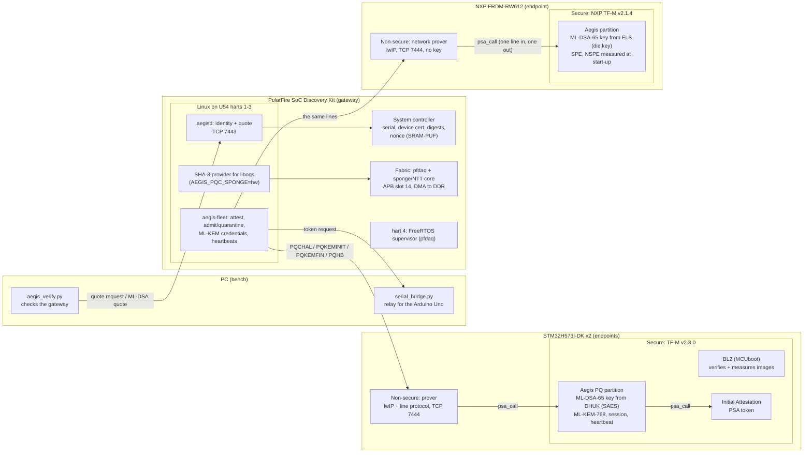
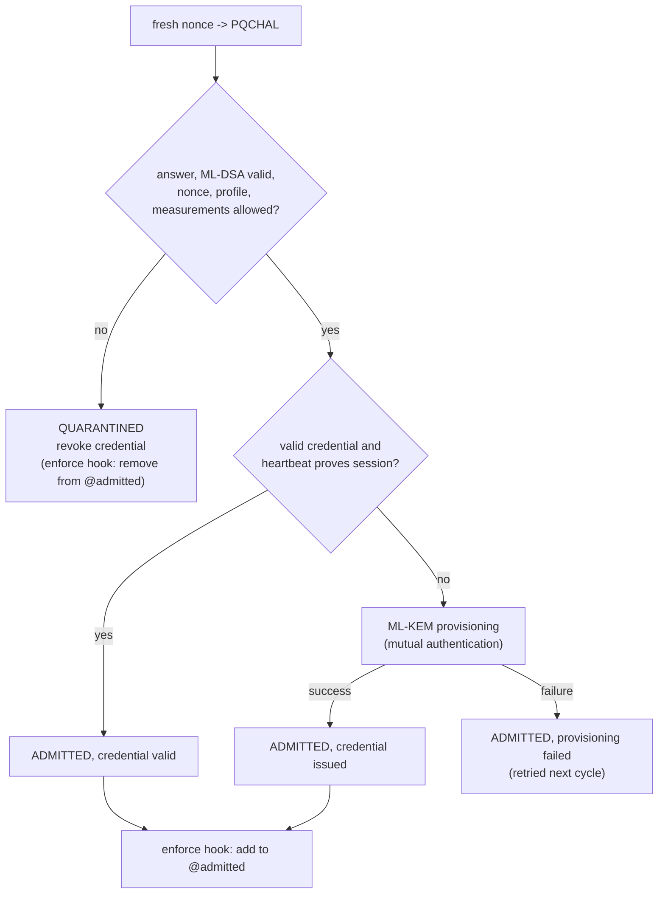

# Aegis architecture (as built, 2026-11-18)

Aegis is a bench prototype of a post-quantum attestation gateway. A PolarFire SoC:
- decides which endpoints may be trusted, from evidence the endpoints' secure hardware produces;
- gives admitted endpoints a credential and a session key established with ML-KEM.

This page describes what exists and runs today. The limits are in `threat-model.md`, the results in the phase notes
and in `evidence/`.

## Components

| Component | Where | What it does |
|---|---|---|
| `gateway/aegisd/aegisd.py` | PolarFire Linux, systemd `aegisd` | gateway identity (ML-DSA-65, software key) bound to the chip's serial number, Microchip device certificate and design info; answers quotes with live platform measurements |
| `gateway/sysserv/aegis_sysserv.py` | PolarFire Linux | read-only whitelist over the system-controller mailbox |
| `gateway/aegisd/fleet.py` | PolarFire Linux, systemd `aegis-fleet` | every 30 s: attest each endpoint, decide, issue or revoke credentials, check heartbeats; reloads the policy each cycle |
| `gateway/policy/fleet.json` | PolarFire | endpoints, enrolled keys, allowed measurements, pinned claims profiles |
| `hw/rtl` | PolarFire fabric, FIC3 APB slot 14 | version 2: the SHA-3 sponge kept in the fabric, squeezed blocks by DMA into DDR, and the FIPS 203/204 NTT (`docs/accelerator-v2.md`) |
| `gateway/pqc` | PolarFire Linux | user-space driver, self-test, liboqs SHA-3 provider (`AEGIS_PQC_SPONGE=hw`; the services do not set it) |
| `endpoints/stm32h573/tfm-aegis-partition` | STM32 secure world | device key, quotes, ML-KEM provisioning, mutual authentication, KMAC heartbeats |
| `endpoints/stm32h573/prover-ns` | STM32 non-secure world | Ethernet (lwIP, LAN8742A) and the line protocol; holds no keys |
| `endpoints/rw612/tfm` | RW612: TF-M partition `aegis_pq` and the non-secure `prover_ns` | the partition runs the protocol code (`endpoints/rw612/prover/src/aegis_proto.c`) on every line; the non-secure side only carries the network |
| `endpoints/rw612/prover` | RW612, Zephyr (the first, single-image prover) | same protocol code; it measures itself, labelled device-key trust; superseded on the bench by the TF-M version |
| `endpoints/arduino-uno` | Arduino Uno, through `host/serial_bridge.py` | a node with no keys and no measured boot: always quarantined |
| `endpoints/zybo` | a Linux endpoint (written for a Zybo Z7-10); tested on the PC, not on the bench | the same protocol in Python; key in a file, measurements by the running Linux, labelled software trust |
| `endpoints/zynqmp` | Trenz TE0807 (XCZU4EG), Debian 12 on the A53s, boot chain built here (Vitis 2025.2 FSBL, TF-A, U-Boot) | first the Linux prover (software trust); since 18 November 2026 the Aegis TA in OP-TEE on the A53s, Linux only carrying the lines; admitted as `zynqmp-te0808`; since 19 November with the key bound to the chip's PUF (encrypted, boot-header-authenticated boot, no eFUSE) and trustzone trust (`docs/zynqmp-key-design.md`) |
| `host/` | PC | gateway verifier, console tools, the Arduino relay |
| `tests/fuzz` | PC and CI | libFuzzer harnesses for both endpoint partitions, with a model of the protocol |

## Trust anchors

| Anchor | Holder | Strength on this bench |
|---|---|---|
| STM32 device key | ML-DSA-65 derived at boot from the STM32H5 DHUK inside SAES | per chip; protected by TrustZone; product state Open with development keys (see the threat model) |
| RW612 device key | ML-DSA-65 derived from the die key in ELS (CKDF, HMAC) by the TF-M partition | per chip; ELS reachable by secure privileged code only; no secure boot fused, so the same chip key serves any secure image; the gateway pins the claims profile |
| Measurements | STM32: TF-M BL2 (MCUboot). RW612: the secure partition hashes both flash partitions whole before non-secure code runs | STM32 images verified with TF-M development keys; RW612 secure image not verified at boot |
| Gateway identity key | `/var/lib/aegis/identity.sk` (0600) | software key: the MPFS095T (non-S) has no key-holding data-security services |
| Gateway key at the endpoint | pinned in each endpoint's secure image at build time | as strong as the secure image |
| Policy | gateway file system | edited by the operator; `enroll-pq` keeps existing pins |

## Protocols (all over TCP, one request per connection, hex lines on the endpoint side)

**Gateway quote** (PC -> gateway, length-prefixed JSON): nonce -> body {nonce, identity hash, measurements: design
info, usercode, security locks, design digests, aegisd code hash, kernel, boot id} + ML-DSA-65 signature (label
`aegis-quote-v1`).

**Endpoint attestation** (gateway -> endpoint): `PQCHAL <nonce>` -> claims plus an ML-DSA-65 signature by the device
key over `aegis-endpoint-quote-v1\0 || claims`. The gateway checks the signature against the enrolled key, the
nonce, the profile where one is pinned, and every measurement against the policy.
- **STM32:** the claims are the TF-M PSA token (COSE_Sign1; challenge, instance ID, boot measurements of SPE and NSPE
  with signer IDs).
- **RW612:** CBOR claims with PSA claim numbers: profile `aegis-rw612-tfm-v1`, challenge, instance ID, and the `SPE`
  and `NSPE` components.

ML-DSA signing is hedged on both: fresh randomness in every signature.

**Provisioning** (only after ADMITTED):
1. `PQKEMINIT <nonce>` -> a fresh ML-KEM-768 encapsulation key `ek`, signed by the device key with the nonce. A new
   `PQKEMINIT` cancels any pending exchange.
2. The gateway encapsulates and sends `PQKEMFIN <ct> <credential>`. The credential is signed by the gateway key and
   names SHA3-256(ct), SHA3-256(ek) and the endpoint's key.
3. The endpoint verifies against the pinned gateway key, decapsulates and answers a key-confirmation tag.

Both sides keep session = SHA3-256("aegis-session-v1" || K || nonce || SHA3(ct)); the key never leaves either side.
A credential lasts an hour and is renewed five minutes before it expires.

**Heartbeat** (every cycle while a credential is valid): `PQHB <nonce>` -> status text, counter,
KMAC256(session, nonce || counter || status, 256, "aegis-hb-v2") (NIST SP 800-185). The gateway needs the counter to
rise within a session. A failure leads to re-provisioning; QUARANTINED deletes the credential and session key on the
gateway.

## Decision loop (aegis-fleet, every 30 s)

The verdict names the trust behind it:
- `trustzone` for the RW612's TF-M partition;
- `device-key` for a single-image prover with a hardware key;
- `software` for a Linux prover whose key is a file.

Enforcement (the hook and nftables ruleset in `gateway/enforce/`) needs the gateway in the traffic path and the
rebuilt kernel (`docs/phase4-notes.md`). Today the gateway decides and records.

## Where things run and how to check them

- `tools/regression.sh --board`: host tests, red-team, RTL simulation, ACVP on PC, gateway checks, fabric self-test,
  ACVP with the fabric, fleet admission, session, heartbeat, device red-team.
- `tests/fuzz/run.sh` and `STM32=1 tests/fuzz/run.sh`: the endpoint partitions under libFuzzer, ASan and UBSan
  (also in CI).
- `tools/demo.sh`: the end-to-end story on the boards in under 2 minutes.
- Every board change and how to undo it: `docs/board-changes.md`.
