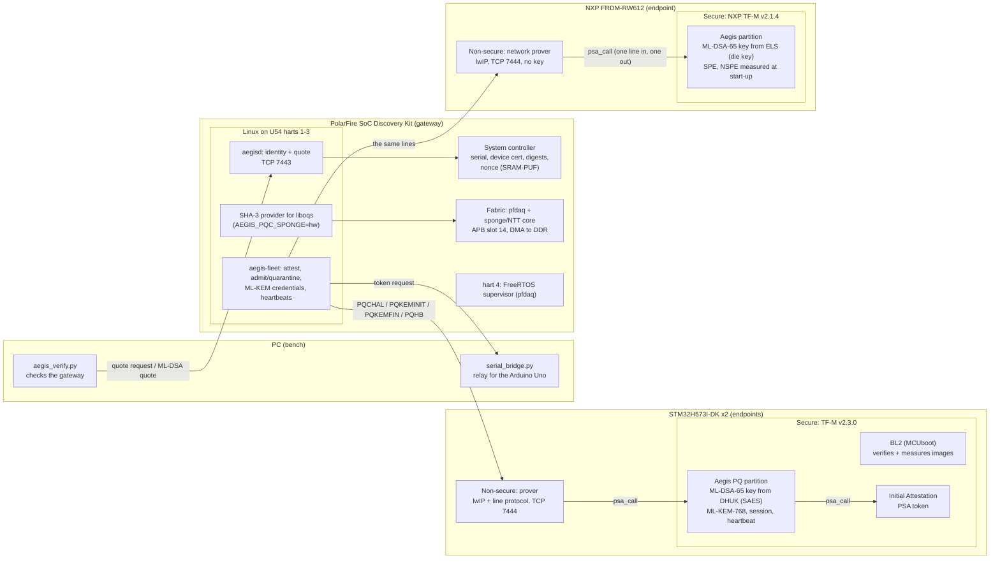
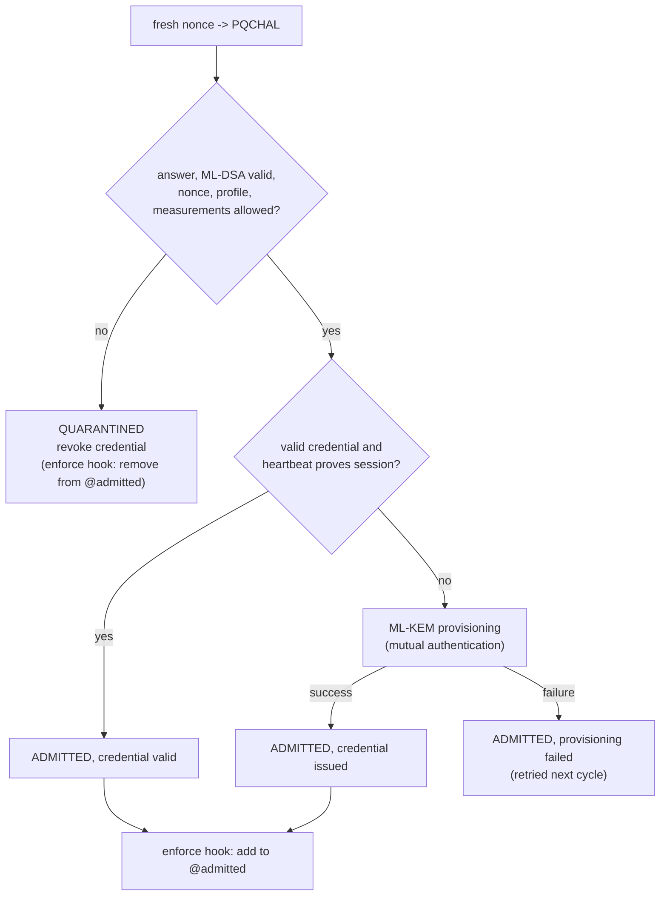

# Aegis architecture (as built, 2026-11-18; updated 2026-11-20)

Aegis is a bench prototype of a post-quantum attestation gateway. A PolarFire SoC:
- decides which endpoints may be trusted, from evidence the endpoints' secure hardware produces;
- gives admitted endpoints a credential and a session key established with ML-KEM.

This page describes what exists and runs today. The limits are in `threat-model.md`, the results in the phase notes
and in `evidence/`.

## Components

| Component | Where | What it does |
|---|---|---|
| `gateway/aegisd/aegisd.py` | PolarFire Linux, systemd `aegisd`; or any Linux host with `--platform linux` | gateway identity (ML-DSA-65, software key) bound to the chip's serial number, Microchip device certificate and design info; answers quotes with live platform measurements. With `--platform linux` (the default off the board) it needs no system controller: the host is named by a hash of `/etc/machine-id`, the quote carries what the running system reports, and identity and quote say `linux-host` (`tests/host/test_linux_host_verifier.py`) |
| `gateway/sysserv/aegis_sysserv.py` | PolarFire Linux | read-only whitelist over the system-controller mailbox |
| `gateway/aegisd/fleet.py` | PolarFire Linux, systemd `aegis-fleet` | every 30 s: attest each endpoint, decide, issue or revoke credentials, check heartbeats; reloads the policy each cycle |
| `gateway/policy/fleet.json` | PolarFire | endpoints, enrolled keys, allowed measurements, pinned claims profiles |
| `hw/rtl` | PolarFire fabric, FIC3 APB slot 14 | version 2: the SHA-3 sponge kept in the fabric, squeezed blocks by DMA into DDR, and the FIPS 203/204 NTT (`docs/accelerator-v2.md`) |
| `gateway/pqc` | PolarFire Linux | user-space driver, self-test, liboqs SHA-3 provider (`AEGIS_PQC_SPONGE=hw`; the services do not set it) |
| `sdk/` | every endpoint's secure side, and the PC | the Prover SDK: the protocol core all devices build (`sdk/src/aegis_proto.c`), its platform interface, a reference port for the PC and a prover for Linux user space (below, and `sdk/README.md`) |
| `endpoints/stm32h573/tfm-aegis-partition` | STM32 secure world | the SDK's port: device key from the DHUK, TF-M's token as evidence, the RTC as session clock, the service's PSA messages; the core does quotes, ML-KEM provisioning, mutual authentication, KMAC heartbeats |
| `endpoints/stm32h573/prover-ns` | STM32 non-secure world | Ethernet (lwIP, LAN8742A) and the line protocol; holds no keys |
| `endpoints/rw612/tfm` | RW612: TF-M partition `aegis_pq` and the non-secure `prover_ns` | the partition runs the SDK's core on every line (`aegis_pq/aegis_pq.c` is its port: ELS key and DRBG, secure SysTick, the two measurements); the non-secure side only carries the network |
| `endpoints/rw612/prover` | RW612, Zephyr (the first, single-image prover) | same protocol code; it measures itself, labelled device-key trust; superseded on the bench by the TF-M version |
| `endpoints/arduino-uno` | Arduino Uno, through `host/serial_bridge.py` | a node with no keys and no measured boot: always quarantined |
| `endpoints/zybo` | the Linux prover, first written for a Zybo Z7-10; that board is retired and the Zynq UltraScale+ endpoint replaces it | the same protocol in Python; key in a file, measurements by the running Linux, labelled software trust; it ran on the ZynqMP for the software-trust step (`evidence/zynqmp/software-trust.txt`) |
| `endpoints/zynqmp` | Trenz TE0807 (XCZU4EG), Debian 12 on the A53s, boot chain built here (Vitis 2025.2 FSBL, TF-A, U-Boot) | first the Linux prover (software trust); since 18 November 2026 the Aegis TA in OP-TEE on the A53s, Linux only carrying the lines; admitted as `zynqmp-te0808`; since 19 November with the key bound to the chip's PUF (encrypted, boot-header-authenticated boot, no eFUSE) and trustzone trust (`docs/zynqmp-key-design.md`) |
| `host/` | PC or any Linux host | gateway verifier, console tools, the Arduino relay |
| `common/` | gateway and host | wire formats (a CBOR decoder that refuses maps with non-scalar or repeated keys, `tests/host/test_cbor_keys.py`), KMAC, and ML-DSA/ML-KEM through OpenSSL 3.5+ or liboqs (`AEGIS_PQ_BACKEND`) |
| `tests/fuzz` | PC and CI | libFuzzer harnesses with a model of the protocol: one on the SDK's core for both transports and every configuration, one on the STM32 port's own code (PSA messages, the RTC, the stack mark) |

## The Prover SDK: one protocol source, a platform layer per chip

Since 20 November 2026 every device builds the same protocol source, `sdk/src/aegis_proto.c`, the core of the
Prover SDK (`sdk/README.md` is the guide for a device maker, `sdk/include/aegis_sdk.h` the interface). Until then
the STM32 partition carried 1100 lines of its own for the same protocol. A device is now three parts:

- **the core**: quote, exchange, credential check, transcript, heartbeat and the session's end. It allocates
  nothing, includes nothing of TF-M, Zephyr, OP-TEE or a vendor HAL, and keeps its state in a context and one work
  buffer the port provides (13.2 KB and 1.2 to 2.9 KB);
- **a platform file**: randomness, a clock, the measurements or a finished token, the identity seed or a signing
  function, a status text. A function that fails makes the core refuse the request;
- **a transport**: the core is a function from one request to one reply, as a text line
  (`aegis_prover_handle_line`, what the gateway speaks) or as binary operations (`aegis_prover_quote` and the
  others, which the STM32's PSA messages map onto one to one).

| | STM32H573 (TF-M) | RW612 (TF-M) | RW612 (single image) | ZynqMP (OP-TEE) | Linux | PC (reference port) |
|---|---|---|---|---|---|---|
| Platform file | `endpoints/stm32h573/tfm-aegis-partition/aegis_pq_attest.c` | `endpoints/rw612/tfm/aegis_pq/aegis_pq.c` | `endpoints/rw612/prover/src/main.c` | `endpoints/zynqmp/optee/ta/aegis_ta.c` | `sdk/ports/linux/aegis_port_linux.c` | `sdk/ports/host/aegis_port_host.c` |
| Identity seed | AES-256(DHUK) in SAES | ELS: HMAC(CKDF(die key)) | the same | OP-TEE's hardware unique key, per TA | random at first start, in a file | an argument |
| Randomness | TF-M crypto service (the RNG peripheral) | ELS DRBG | Zephyr entropy driver | `TEE_GenerateRandom` | `getrandom` | `getrandom` |
| Clock | RTC on the LSI, made secure, 250 Hz | secure SysTick | Zephyr uptime | OP-TEE system time, protection level 1000 | `CLOCK_BOOTTIME` | `CLOCK_MONOTONIC` |
| Evidence | TF-M's PSA token (`evidence`) | SPE and NSPE, hashed before the non-secure image runs | APP, hashed at every quote | the FSBL's hand-off | files, hashed at every quote | files, hashed at every quote |
| Transport | PSA messages, binary operations | lines in one PSA message | lines over TCP | lines in one TA command | lines over TCP | lines over TCP |
| Trust the profile claims | hardware | hardware | device key | hardware (with the PUF seed) | software | none (tests) |

**The same answers as before.** The STM32 port had to stay byte-compatible with the image on the boards (SPE
3183f74a): same messages, sizes, PSA statuses, signatures, keys and tags. `tools/sdk_golden.py` builds the harnesses
of the commit before the SDK with a trace of every byte answered, and `tests/host/test_sdk_golden.py` holds the
new code to the recorded traces for a fixed generator (30 STM32 seeds, 18 line-protocol seeds); the same
comparison ran over the fuzzers' corpora (704 STM32 inputs and 478 line-protocol inputs after 200 s of fuzzing
each: none differs, `evidence/sdk-core/summary.txt`). Two habits of the STM32 partition differ from the other devices and are kept behind
compatibility flags of the core: its heartbeat counter runs from boot across sessions, and it does not require the
credential to name the device's key (it requires the exchange's ML-KEM key, which no other device has). What is
refused now and was not before, on every family, none of it reachable with a working device and a valid request:
a random draw for an exchange's key of 32 equal bytes (the STM32 partition refused zeros only, the others nothing)
or equal to the generator's draw before it (`ERR rng`); a seed or an exchange root of zeros at start; a platform
that gives no measurement, one without a label, or evidence longer than it has room for (`ERR evidence`).

**Inputs are read once.** Whatever a caller passes to the core must be in memory nothing less trusted can write
during the call; every port copies a request into the secure world first. As a second line of defence the binary
operations copy what they check before they check it (the credential's body and signature, the ciphertext, the
challenge, the nonce) and never go back to the caller's memory, so a credential that passed is the credential that
is used (`tests/host/test_sdk_core_contract.py`, which overwrites the caller's buffers in mid-operation, and holds
the other boundaries a careless change would move: the credential against the work buffer, the length a platform
reports for its evidence, a heartbeat status buffer one byte short).

**State.** The core needs no persistent storage, and a port must not give it any: the session and the quote an
exchange may continue live in the context, which `aegis_prover_init` wipes at every start.

**What it does not change.** The protocol, the limits of the transcript above (an image that holds the key and
lies; a key that depends on the measured code is the remedy, and belongs in the platform's identity functions),
and the trust each endpoint claims. Endorsed enrolment needed nothing from the core (it uses `PQKEY` and `PQCHAL`;
[enrolment.md](enrolment.md)); an endorsement carried by the device is later work, and `sdk/README.md` names the
functions it attaches to. Evidence as an EAT in a COSE_Sign1 is an option of the core that is off by default
([evidence-format.md](evidence-format.md), which also defines what T1 hashes for it, the verifier's signed
attestation result and the evidence pack).

What was built from this source (after the review of 20 November 2026; the builds before its fixes were `-sdk`,
SPE b876213a, and RW612 0.3.1, SPE b48d2ecf):

| Device | Image | State |
|---|---|---|
| STM32H573 (TF-M) | `...-freshkem-transcript-sdk2`, SPE 9de76167, the same MCUboot version (2.3.0) and signer as the image before the SDK | built with `build_tfm.sh`; held to the answers of SPE 3183f74a byte for byte on the PC; deepest stack path by GCC's figures 18704 bytes (`tools/stack_estimate.py`; 18712 for SPE 3183f74a, which reports `sstack=18880/26624`, so about 18872 is expected); 448 bytes less secure RAM, 3.6 KB more flash than that image |
| RW612 (TF-M) | secure image 0.3.2, SPE c8d0f012; the non-secure image is byte for byte 0.2.2's (NSPE 24979a1f) | built; secure RAM 176924 to 161828 bytes of 192 KB (the core no longer copies the credential, the claims and the gateway's key) |
| RW612 (single image) | | source only (no Zephyr workspace on the build PC) |
| ZynqMP (OP-TEE TA) | | source; `optee/tests/run.sh` runs the TA with the core on a stand-in for OP-TEE (also in CI); no `.ta` built on this PC |
| Linux | `sdk/ports/linux`, a prover in C with the Python prover's command line, profile and measurements | PC-tested with the gateway's code (`tests/host/test_sdk_linux_port.py`); the bench's Linux endpoints keep the Python prover |

Since then the STM32 image (SPE 9de76167; on board 2 its build with standard evidence), the RW612's 0.3.2 and the
ZynqMP's TA 0.2.0 (since 20 November 2026, [zynqmp-sdk-port.md](zynqmp-sdk-port.md)) run on the bench.

## Trust anchors

| Anchor | Holder | Strength on this bench |
|---|---|---|
| STM32 device key | ML-DSA-65 derived at boot from the STM32H5 DHUK inside SAES | per chip; protected by TrustZone; product state Open with development keys (see the threat model) |
| RW612 device key | ML-DSA-65 derived from the die key in ELS (CKDF, HMAC) by the TF-M partition | per chip; ELS reachable by secure privileged code only; no secure boot fused, so the same chip key serves any secure image; the gateway pins the claims profile |
| Measurements | STM32: TF-M BL2 (MCUboot). RW612: the secure partition hashes both flash partitions whole before non-secure code runs | STM32 images verified with TF-M development keys; RW612 secure image not verified at boot |
| Gateway identity key | `/var/lib/aegis/identity.sk` (0600) | software key: the MPFS095T (non-S) has no key-holding data-security services |
| Gateway key at the endpoint | pinned in each endpoint's secure image at build time | as strong as the secure image |
| Policy | gateway file system | edited by the operator; `enroll-pq` keeps existing pins. Whoever can write it decides which endorsers are trusted and which entries must be endorsed, unless the verifier was given policy-signing keys (below) |
| Policy-signing key (ML-DSA-65), optional | the operator's machine, `~/.local/state/aegis-policy-signer`; the verifier has the public key in `policy-signers.json` | off by default. With it the verifier runs only from a policy signed by that key (COSE_Sign1), of a version not lower than the last it accepted ([audit-and-policy.md](audit-and-policy.md)) |
| Endorser key (ML-DSA-65) | the bench PC, `~/.local/state/aegis-endorser`: sealed to its TPM, else a 0600 file | signs endorsement records ([enrolment.md](enrolment.md)); whoever can use it can make any key a trusted device key at each verifier that lists it |
| Endorsement record per device | `endorsements/<name>.json` beside the policy | for an entry with `"endorsement": "required"`, the only way a device key is trusted: signed by a listed endorser, naming the device, its family, the key and the components appraised at the bench. As good as the cable the device was on when it was endorsed; the devices are in their development state |

## Protocols (all over TCP, one request per connection, hex lines on the endpoint side)

**Gateway quote** (PC -> gateway, length-prefixed JSON): nonce -> body {nonce, identity hash, measurements: design
info, usercode, security locks, design digests, aegisd code hash, kernel, boot id} + ML-DSA-65 signature (label
`aegis-quote-v1`).

**Endpoint attestation** (gateway -> endpoint): `PQCHAL <nonce>` -> claims plus an ML-DSA-65 signature by the device
key over `aegis-endpoint-quote-v1\0 || claims`. The gateway checks the signature against the enrolled key, the
nonce, the profile where one is pinned, and every measurement against the policy.
- **STM32:** the claims are the TF-M PSA token (COSE_Sign1; challenge, instance ID, boot measurements of SPE and NSPE
  with signer IDs).
- **RW612:** CBOR claims with PSA claim numbers: profile `aegis-rw612-tfm-v1`, challenge, instance ID, and the `SPE`
  and `NSPE` components.

ML-DSA signing is hedged on both: fresh randomness in every signature.

**Provisioning** (only after ADMITTED):
1. `PQKEMINIT <nonce>` -> a fresh ML-KEM-768 encapsulation key `ek`, signed by the device key with the nonce (or,
   with "One transcript" below, with the quote it continues). A new `PQKEMINIT` cancels any pending exchange. The key pair's coins are SHA3-256(root || fresh || nonce || counter ||
   0 or 1) for the two halves: a device secret, 32 bytes from the chip's random number generator, the gateway's
   nonce and the count of exchanges since reset. The random bytes keep a recorded exchange from being replayed
   after a reset (the other inputs repeat); without them the exchange is refused. In the STM32 partition's source
   from 20 November 2026 (image `...-freshkem`, SPE 67a452b1, on both boards since 20 November 2026: `evidence/stm32-freshkem/`); the RW612 had them from the start.
2. The gateway encapsulates and sends `PQKEMFIN <ct> <credential>`. The credential is signed by the gateway key and
   names SHA3-256(ct), SHA3-256(ek), the endpoint's key and its validity (`issued`, `expires`).
3. The endpoint verifies against the pinned gateway key, decapsulates and answers a key-confirmation tag.

Both sides keep session = SHA3-256("aegis-session-v1" || K || nonce || SHA3(ct)); the key never leaves either side.
A credential lasts an hour and is renewed five minutes before it expires.

**One transcript** (policy `"transcript": "v2"`; audit finding 2. STM32: on both boards since 20 November 2026
(`evidence/transcript-v2/`); RW612: TF-M 0.3.2 (SPE c8d0f012) on the board; ZynqMP: OP-TEE TA 0.2.0 on the board since 21 November 2026, see `zynqmp-sdk-port.md`; the Linux prover: source only.) The two
exchanges above share nothing but the endpoint's key: the signature on the ML-KEM key covers `nonce || ek` and says
nothing about the code that reported the measurements. Where one key serves two firmware images, the gateway can
appraise one and finish the session with the other. That is the case on this bench: the RW612's single-image prover
and its TF-M partition derive the same key, an STM32 secure image has the same DHUK-derived key before and after an
upgrade, and the non-secure image can change under the same secure one. With `"transcript": "v2"` in an endpoint's
policy entry, the quote and the exchange are one hash chain (`common/transcript.py`):

    T1 = SHA3-256("aegis-transcript-v2/quote"    || challenge[32] || SHA3-256(token)[32])
    T2 = SHA3-256("aegis-transcript-v2/kem-init" || T1[32] || ek[1184])
    T3 = SHA3-256("aegis-transcript-v2/kem-fin"  || T2[32] || SHA3-256(ct)[32] || SHA3-256(credential)[32])

    PQKEMEK signature   ML-DSA-65 by the device key over "aegis-kem-init-v2" || 0x00 || T2
    credential          as above, and its signed body names T2: "transcript_sha3_256":"<64 hex digits>"
    PQKEMOK tag         SHA3-256("aegis-confirm-v2" || K[32] || T3[32])
    session key         SHA3-256("aegis-session-v2" || K[32] || T3[32])

- **Fields.** `challenge`: the gateway's 32 random bytes of this cycle. `token`: the bytes the endpoint signed as its
  quote, exactly as sent (the STM32's PSA token, the CBOR claims elsewhere); they hold the challenge and the
  measurements. `ek`, `ct`: the ML-KEM-768 encapsulation key and ciphertext. `credential`: body, newline and
  signature, as sent. `K`: the ML-KEM shared secret. The labels are ASCII without a terminator (25, 28, 27, 16 and 16
  bytes); every other field has a fixed length, so the five hash inputs are 89, 1244, 123, 80 and 80 bytes, and no
  label is the beginning of another.
- **The lines do not change.** `PQKEMINIT` carries the challenge of the quote in the place of its nonce: that is how
  the endpoint knows which quote the exchange continues. The STM32's non-secure prover passes the same bytes to the
  same message types; it is not rebuilt.
- **Endpoint.** Its secure side keeps the challenge and T1 of the last quote it signed since reset, in RAM. A
  `PQKEMINIT` whose nonce is that challenge continues that quote, once: the signature is over T2, the credential
  must name T2 (otherwise it is refused like one for another key, and an established session stays), and tag and
  session key come from T3. Another `PQCHAL` replaces the quote. A `PQCHAL` whose challenge was read ends the quote
  before anything else, so one whose token or signature then fails leaves none to continue; a malformed one (no
  32-byte challenge) is refused before that and leaves the quote as it was. A first use and a reset end it too. Any
  other nonce gets the first version's exchange, unchanged, so an upgraded endpoint still works with a gateway whose
  policy does not ask for the transcript yet.
- **Gateway.** With the policy key it sends the challenge of the quote it has just appraised, computes T2 from the
  token bytes it appraised and the key it received, and checks the signature over that. Any other answer to
  `PQKEMINIT` (a signature of the first version, one over another quote, another key or another step, an error line, a
  malformed or wrong-length key or signature) is `provisioning REFUSED` before a credential is sent. A stored session
  that still works (made the bound way from an earlier admitted quote, not expired, its heartbeat not failed: in
  practice one in its last five minutes, being renewed) is kept until it expires; one that is already unusable (its
  heartbeat failed, or it was made another way than the policy asks for) is deleted. A stored session that was not
  made the bound way is replaced, not kept alive by heartbeats. Without the policy key the first version's exchange is
  used and marked in every journal line (`[unbound]`), with the reason at warning priority when such a session is
  issued and when the loop starts; `fleet.py check` says which entries are bound.
- **What is refused** (`tests/host/test_transcript.py`, the fuzz models, `tests/redteam/fuzz_host.py`): the quote
  from one image and the exchange from another, whether the other image knows the transcript or not, and whether or
  not it first signed a quote of its own for the same challenge (its quote reports its own measurements, so its T1
  is another one); the same image after a restart; an exchange before its quote; the quote of an earlier cycle; a
  recorded `PQKEMEK` or `PQKEMOK`; a tag made the first version's way; a credential for another transcript.

What a transcript says, and what it does not:

- **No endpoint measures again for it.** The STM32's token carries what BL2 recorded at boot; the RW612's TF-M
  partition hashes both flash partitions once, before the non-secure image runs; the ZynqMP's TA reports the FSBL's
  hand-off; the RW612's single-image prover and the Linux prover hash their files when a quote is asked for. So a
  transcript says: one boot of the code that holds the key signed exactly this quote and then made this ML-KEM key
  for it. It does not say that the running code is still what was measured at boot.
- **The same boot, or the same quote.** After a reset there is no quote to continue. An endpoint that restarts into
  the same images and is asked for the same challenge again signs the same claims; where the quote is those claims
  alone (RW612, ZynqMP, Linux) it is then the same token, byte for byte, the transcript is the appraised one, and
  finishing it is correct: what answers reports what was appraised. The STM32's token carries TF-M's own ES256
  signature, which t_cose asks for as randomized ECDSA, so there even the same images give another token and a
  quote from before the reset cannot be continued at all (board 2 gave another token for the same challenge after a
  reset: `evidence/transcript-v2/ts-swapreset-b2.txt`).
- **What it protects against, and what not.** It protects against a swap to another image that follows the protocol
  (any image of this repository, old or new) between the quote and the exchange: for example a rollback to an
  image from before the transcript, or a restart into other code. It adds nothing against an attacker who can flash
  code of their own, and on this bench that is anyone with the debugger: the RW612 has no secure boot, and the
  STM32s are in the Open state with TF-M's public development signing keys. Such an image holds the device key and
  can sign T2 for a quote another image made (quotes cross the network in the clear), as it could forge the quote
  itself. Closing this needs a device key that depends on the measured code (derived from the measurements, or
  released by the boot chain only to the measured image); these keys depend on the chip only
  (`test_limit_a_firmware_that_holds_the_key_and_lies_is_accepted` states the boundary).
- **One signature, not two.** The endpoint signs T2. The ciphertext and the credential come later and are covered by
  the tag, which needs K, which only the holder of the decapsulation key of the signed `ek` has; the gateway's
  signature on the credential covers T2.
- **Two verifiers.** An endpoint keeps one quote, so a quote asked by another verifier between the gateway's quote
  and its `PQKEMINIT` makes that exchange fail. The fleet loop then takes one more quote in the same cycle and
  continues that one, only if it is admitted and reports the same measurements as the verdict (`pc-verifier.md`).
  If that second quote is not admitted, it is the cycle's verdict: the endpoint is quarantined, enforced again, and
  the second quote's reasons are in the journal line.

Order of upgrade: the gateway first (`fleet.py` and `common/transcript.py`; nothing changes for entries without the
key), then each endpoint image, then `"transcript": "v2"` in that endpoint's entry. With the key set for an image
from before the transcript, the endpoint is still attested and admitted, and gets no session.

| Endpoint | Where | State |
|---|---|---|
| STM32H573 (TF-M) | `aegis_pq_attest.c`; non-secure prover 0.6.0 unchanged | on both boards since 20 November 2026: image `...-freshkem-transcript`, SPE 3183f74a, same MCUboot version (2.3.0) and signer as the image before (67a452b1); deepest stack path by GCC's figures 18712 bytes (18720 before); both boards report `sstack=18880/26624` (18888 before). `transcript_swap_check.py` live, reset and swap to 67a452b1 (`evidence/transcript-v2/`) |
| RW612 (TF-M) | `aegis_proto.c` in the secure image, 0.3.0 | image built (SPE 76f89751; the non-secure image is byte for byte 0.2.2's, NSPE 24979a1f), on the board since 20 November 2026; bound exchange accepted, replays and foreign credentials refused (`evidence/transcript-v2/ts-live-rw612.txt`) |
| RW612 (single image) | the same `aegis_proto.c` | source only (no Zephyr workspace on the build PC) |
| ZynqMP (OP-TEE TA) | the same `aegis_proto.c` | on the board since 20 November 2026 (TA 0.2.0, BOOT.BIN e540d774, `zynqmp-sdk-port.md`); `optee/tests/run.sh` checks the TA's transcript on the PC |
| Linux prover | `aegis_linux_prover.py` 0.3.0 (needs `common/transcript.py` beside it) | source only; its own `PROVER` measurement changes with the file |

On a board: `tests/board/transcript_swap_check.py` (its text says what each step shows).

**The session's end** (`endpoint-expiry.md`; checked on the STM32s and the RW612 by the regression's `endpoint-expiry`
stage, `evidence/console/regression-14of14-20261119.txt`): both sides end it.
- **The gateway** by its own clock: it stops using a session five minutes before the credential's `expires` and
  provisions again.
- **The endpoint** on a clock of its secure side: the credential's lifetime (`expires - issued`, from the signed
  text) plus a sixteenth after the accepted `PQKEMFIN`, it wipes the session key. `PQHB` and `PQSESSION` then answer
  `ERR pq expired`. The clock is one the non-secure side cannot set or stop: the RTC on its own oscillator on the
  STM32, the secure SysTick on the RW612, OP-TEE's system time (the physical counter) on the ZynqMP. The heartbeat
  status ends with the seconds left, `;ttl=<n>`.

**Heartbeat** (every cycle while a credential is valid): `PQHB <nonce>` -> status text, counter,
KMAC256(session, nonce || counter || status, 256, "aegis-hb-v2") (NIST SP 800-185). The gateway needs the counter to
rise within a session. The status carries the secure partition's stack high-water mark: the STM32 partition appends
";sstack=<used>/<size>" to the non-secure text before MACing it (secure image with prover 0.6.0 and later), the RW612
partition writes "stack=<used>/<size>" into its own status. A failure leads to re-provisioning, as does an endpoint
that has ended the session itself; QUARANTINED deletes the credential and session key on the gateway.

## Decision loop (aegis-fleet, every 30 s)

With `"audit_log": true` in the policy (off by default) the loop also keeps a signed, hash-chained log of what it
decided under `STATE_DIR/audit/`: an entry when a decision, a session or the policy changes, one ML-DSA-65 signature
per batch by the gateway's identity key, nothing in a cycle where nothing changed
([audit-and-policy.md](audit-and-policy.md); `fleet.py audit`, `tools/verify_audit.py`). It has run on the bench gateway since 21 November 2026 (`audit-and-policy.md`, "Measured on the bench").

The verdict names the trust behind it:
- `trustzone` for the RW612's TF-M partition, the ZynqMP's OP-TEE TA with the PUF-bound key, and a TF-M (kind
  `aegis-pq`) endpoint whose policy pins any attestation key other than TF-M's published development key;
- `trustzone-devkey` for a TF-M (kind `aegis-pq`) endpoint whose policy pins TF-M's published development
  attestation key, as on the bench's STM32s: the token proves only what the endpoint's ML-DSA-65 key vouches for;
  the verdict carries a warning, so the signed result's status is "warning", not "affirming" (a kind `aegis-pq`
  entry that pins no attestation key gets no label);
- `development-shared-key` for the ZynqMP's development profile (one key on every chip; refused unless allowed), and
  for a kind `psa` endpoint pinned to TF-M's development key (its only signature; with a warning);
- `device-key` for a single-image prover with a hardware key;
- `software` for a Linux prover whose key is a file.

Enforcement (the hook and nftables ruleset in `gateway/enforce/`) needs the gateway in the traffic path and the
rebuilt kernel (`docs/phase4-notes.md`). Today the gateway decides and records. The ruleset, and the one-port VLAN
design, are tested in network namespaces only (`tests/host/test_enforcement.sh`, `tests/host/test_enforcement_vlan.sh`;
`evidence/console/enforcement.txt`, `evidence/console/enforcement-vlan.txt`), not on a VLAN switch.

## Where things run and how to check them

- `tools/regression.sh --board`: host tests (87 in `tests/host/`), red-team, RTL simulation, ACVP on PC, the ACVP
  vector checksums, gateway checks, fabric self-test, ACVP with the fabric (per permutation and with the sponge),
  fleet admission, session, heartbeat, device red-team: 13 stages, 14 with `--with-expiry`
  (`evidence/console/regression-14of14-20261119.txt`). With `--with-expiry` (or
  `AEGIS_REGRESSION_EXPIRY=1`) also `endpoint-expiry`: the session's end on every endpoint that holds a session
  (`docs/endpoint-expiry.md`), with the fleet service stopped for it and started again afterwards.
- `tests/fuzz/run.sh` and `STM32=1 tests/fuzz/run.sh`: the Prover SDK's core and the STM32 port under libFuzzer, ASan
  and UBSan (also in CI). `tools/sdk_golden.py check`: the same answers as before the SDK, byte for byte.
- `tools/demo.sh`: the end-to-end story on the boards in under 2 minutes.
- Every board change and how to undo it: `docs/board-changes.md`.
