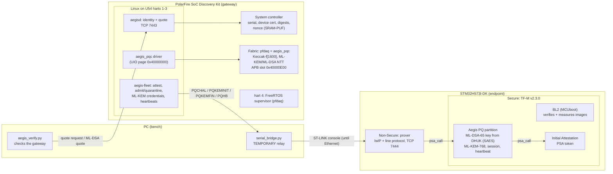
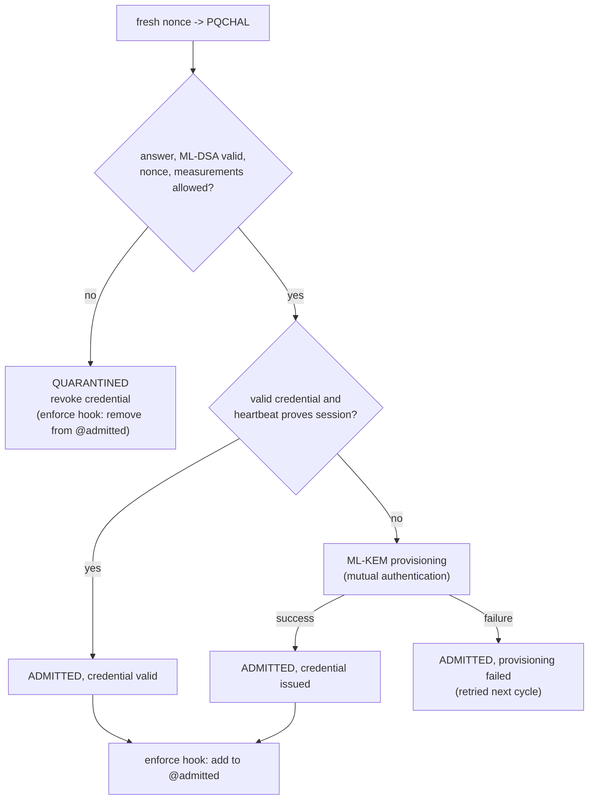

# Aegis architecture (as built, 2026-11-16)

Aegis is a bench prototype of a post-quantum attestation gateway: a PolarFire SoC decides which
endpoints may be trusted, from evidence the endpoints' secure hardware produces, and gives admitted
endpoints a credential and a session key established with ML-KEM. This page describes what exists
and runs today; limits are in `threat-model.md`, results in the phase notes.

## Components

| Component | Where | What it does |
|---|---|---|
| `gateway/aegisd/aegisd.py` | PolarFire Linux, systemd `aegisd` | gateway identity (ML-DSA-65, software key) bound to the chip's serial number, Microchip device certificate and design info; answers quotes with live platform measurements |
| `gateway/sysserv/aegis_sysserv.py` | PolarFire Linux | read-only whitelist over the system-controller mailbox |
| `gateway/aegisd/fleet.py` | PolarFire Linux, systemd `aegis-fleet` | every 30 s: attest each endpoint, decide, issue or revoke credentials, check heartbeats; reloads the policy each cycle |
| `gateway/policy/fleet.json` | PolarFire | endpoints, enrolled keys, allowed measurements (SPE, NSPE) |
| `hw/rtl` (aegis_pqc) | PolarFire fabric, FIC3 APB slot 14 | Keccak-f[1600] (24 cycles), FIPS 203/204 NTT (904/1032 cycles) at 50 MHz |
| `gateway/pqc` | PolarFire Linux | user-space driver, self-test, liboqs Keccak hook (`AEGIS_PQC_KECCAK=hw|check`) |
| `endpoints/stm32h573/tfm-aegis-partition` | STM32 secure world | device key, quotes, ML-KEM provisioning, mutual authentication, heartbeats |
| `endpoints/stm32h573/prover-ns` | STM32 non-secure world | Ethernet (lwIP, LAN8742A) and console line protocol; holds no keys |
| `host/` | PC | gateway verifier, STM32 console tools, temporary relay |

## Trust anchors

| Anchor | Holder | Strength on this bench |
|---|---|---|
| Endpoint device key | ML-DSA-65 derived at boot from the STM32H5 DHUK inside SAES | per chip; protected by TrustZone; product state Open with development keys (see threat model) |
| Boot measurements | TF-M BL2 (MCUboot) | images verified with TF-M development keys |
| Gateway identity key | `/var/lib/aegis/identity.sk` (0600) | software key: the MPFS095T (non-S) has no key-holding data-security services |
| Gateway key at the endpoint | pinned in the STM32 secure image at build time | as strong as the secure image |
| Policy | gateway file system | edited by the operator |

## Protocols (all over TCP, one request per connection, hex lines on the endpoint side)

**Gateway quote** (PC -> gateway, length-prefixed JSON): nonce -> body {nonce, identity hash,
measurements: design info, usercode, security locks, design digests, aegisd code hash, kernel,
boot id} + ML-DSA-65 signature (label `aegis-quote-v1`).

**Endpoint attestation** (gateway -> endpoint): `PQCHAL <nonce>` -> TF-M PSA token for the nonce
(COSE_Sign1; claims: challenge, instance ID, boot measurements of SPE and NSPE with signer IDs) +
ML-DSA-65 signature by the device key over `aegis-endpoint-quote-v1\0 || token`. The gateway checks
the signature against the enrolled key, the nonce, and every measurement against the policy.

**Provisioning** (only after ADMITTED): `PQKEMINIT <nonce>` -> fresh ML-KEM-768 ek signed by the
device key with the nonce; gateway encapsulates, `PQKEMFIN <ct> <credential>` with the credential
signed by the gateway key and bound to SHA3-256(ct); the endpoint verifies against the pinned key,
decapsulates and answers a key-confirmation tag. Both keep
session = SHA3-256("aegis-session-v1" || K || nonce || SHA3(ct)); the key never leaves either side.

**Heartbeat** (every cycle while a credential is valid): `PQHB <nonce>` -> status text, counter,
SHA3-256("aegis-hb-v1" || session || nonce || counter || status). Failure -> re-provision;
QUARANTINED -> credential and session key deleted on the gateway.

## Decision loop (aegis-fleet, every 30 s)

Enforcement (the hook and nftables ruleset in `gateway/enforce/`) needs the gateway in the traffic
path and the rebuilt kernel (`docs/phase4-notes.md`); today the gateway decides and records.

## Where things run and how to check them

- `tools/regression.sh --board`: 12 stages (host tests, red-team, RTL simulation, ACVP on PC,
  gateway checks, fabric self-test, ACVP with fabric Keccak, fleet admission, session, heartbeat,
  device red-team).
- `tools/demo.sh`: the end-to-end story on the boards in under 2 minutes.
- Every board change and how to undo it: `docs/board-changes.md`.
