# Aegis: a post-quantum attestation gateway on PolarFire SoC

Status: bench prototype, measured on real boards, 2026-11-18; updated 2026-11-20. Read `threat-model.md` for everything
this paper does not claim.

## 1. Problem

Industrial and embedded networks mostly trust a device because it is plugged in. Zero-trust
guidance asks for the opposite: a device earns access by proving what it is and what it runs, and
keeps proving it. Two things make that hard for small devices today: the proofs are signed with
classical public-key schemes that a large quantum computer could forge, and the devices cannot run
the heavy verification code a gateway needs.

Aegis shows a small gateway that decides admission from **evidence the endpoint's own secure
hardware produces**, signed and exchanged with the NIST post-quantum algorithms ML-DSA-65
(FIPS 204) and ML-KEM-768 (FIPS 203).

## 2. What was built

- **Gateway**: a PolarFire SoC Discovery Kit (MPFS095T). Linux on three U54 cores runs `aegisd`
  (its own signed quote) and `aegis-fleet` (attest, admit or quarantine, credentials, session
  heartbeats). A fabric block runs the SHA-3 sponge and the NTT; a FreeRTOS supervisor runs on the
  fourth core.
- **Endpoints from three vendors**:
  - **Two STM32H573I-DK** run TF-M v2.3.0 with an added post-quantum partition. An ML-DSA-65 identity key is derived
    inside the secure world from the chip's hardware-unique key and signs the TF-M attestation token together with
    the gateway's challenge.
  - **An NXP FRDM-RW612** runs NXP's TF-M with the Aegis prover as a TrustZone secure partition. The key comes from
    the chip's die key in its EdgeLock Secure Subsystem. Both flash partitions are measured before any non-secure
    code runs, and the non-secure side only carries the network. The peripherals NXP's defaults leave open to
    non-secure code are closed, and each closure was tested on the chip.
  - **A Zynq UltraScale+ module (TE0807)** runs the protocol in an OP-TEE trusted application on the
    Cortex-A53s; Linux only carries the lines (`evidence/zynqmp/optee-phase-a.txt`). It replaces the Zybo Z7-10,
    which is retired.
- **Legacy node**: an Arduino Uno with no keys and no measured boot, to show a device that cannot
  attest.
- **Verifier on a PC** that checks the gateway's own quote, a red-team harness, and a regression
  that exercises all of it on the boards. The gateway's identity and quote service also runs on an ordinary Linux
  host (`aegisd --platform linux`), with OpenSSL (3.5 or later) or liboqs as the ML-DSA/ML-KEM backend
  (`tests/host/test_linux_host_verifier.py`).

## 3. Protocol in one page

1. The gateway sends a fresh challenge to the endpoint.
2. The endpoint returns a TF-M attestation token (image measurements, signer ids, the challenge)
   plus an ML-DSA-65 signature over it from the device key. The first time, the key is enrolled by
   trust on first use.
3. The gateway checks the signature, the nonce and the measurements against its policy. A mismatch
   in any of them means **QUARANTINED**, with the reason logged.
4. If admitted, the gateway runs an ML-KEM-768 exchange: the endpoint encapsulation key is signed by
   the device key; the gateway encapsulates and returns the ciphertext with a credential signed by
   the gateway's ML-DSA-65 key and bound to that ciphertext. The endpoint, which pins the gateway
   key in its secure image, checks both.
5. Both sides now hold a session key. Heartbeats under that key keep the admission alive between
   full re-attestations; a lost or failed session leads to re-provisioning at the next cycle.

## 4. Results

| Claim | Evidence |
|---|---|
| Correct ML-KEM-768 / ML-DSA-65 | NIST ACVP vectors pass on the PC, on the PolarFire with the fabric doing every Keccak permutation, and on the STM32 Cortex-M33 code (265 of 265) |
| Several vendors, one protocol | the STM32s and the RW612 are attested, provisioned and held in KMAC256 sessions by the same gateway code; the RW612's verdict names where its trust comes from: trustzone |
| A compromised non-secure side cannot undo it (RW612) | a one-byte change to the non-secure image is quarantined on its measurement; non-secure reads of 12 protected peripheral blocks fault on the chip |
| Hostile input to the secure partitions | both partitions fuzzed with ASan and UBSan against a model of the protocol: one state bug found and fixed on both; then 1.05 million and 0.89 million executions with nothing found |
| Replay against a real board | the gateway's own key-exchange message, captured and replayed at an STM32, is refused and the session kept |
| Tampered but correctly signed firmware is caught | a Non-Secure image signed with the trusted key boots normally and is QUARANTINED on its measurement; its credential is revoked |
| Devices that cannot attest are refused | the Uno is QUARANTINED on every cycle |
| Attacks on the protocol | 3000 token mutations accepted: 0; 800 hostile endpoint replies admitted: 0; classic-token downgrade and KEM key replay refused; malformed frames do not stop the services |
| Malformed tokens | a claims map with a non-scalar or repeated CBOR key is refused instead of stopping the fleet loop (`tests/host/test_cbor_keys.py`) |
| Whole system | the regression passes 14 of 14 stages on host and boards with `--board --with-expiry`, including ACVP with the second accelerator, heartbeats from the STM32s and the RW612, and the session's end on each endpoint (`evidence/console/regression-14of14-20261119.txt`); its host suite runs 87 tests |

**The fabric accelerator, second version.** The first core computed a Keccak permutation in 24 cycles, but moving
the whole state over the APB bus for every permutation made liboqs 6-12 % slower than software. The second version
keeps the sponge state in the fabric and writes squeezed blocks to DDR by DMA. Measured on the board, ML-KEM-768 is
1.26-1.29 times faster and ML-DSA-65 1.19-1.54 times faster, with the NIST ACVP cases passing
(`accelerator-v2.md`). Signing gains least, because most of its time is polynomial arithmetic rather than hashing.

## 5. Honest limits

- **No network enforcement on the real gateway.** The gateway decides, but a single-port board cannot
  sit in the traffic path without a managed 802.1Q switch, and none is in place. The nftables rules and the
  kernel exist. The rules are tested in network namespaces only: 13 of 13 checks for a second port
  (`evidence/console/enforcement.txt`; the first run found that quarantine did not cut open connections, now fixed)
  and 16 of 16 for the one-port VLAN design, with a VLAN-filtering Linux bridge standing in for the switch
  (`evidence/console/enforcement-vlan.txt`). Neither has run on a real switch.
- **The gateway's own key lives in software.** The board's chip is the non-"S" part: it has no
  hardware crypto block and does not hand a PUF-protected key to software. Linux file permissions
  protect it, and enrolment is trust on first use.
- **Development keys** sign the STM32 images and TF-M's published attestation key is used;
  only the ML-DSA signature is security-relevant. The STM32s are left in their open (not closed)
  product state, and the RW612 has no secure boot fused, so a debugger can still replace its
  secure image. Closing either is irreversible and was not done on this bench.
- **Not evaluated**: side channels, fault injection, power loss during provisioning.
- Not certified. Do not use it to protect anything real.

## 6. Where it goes next

A switch with 802.1Q VLANs to turn decisions into blocked traffic; a gateway key held by hardware (an "S" device or
an external secure element, or a TPM for the Linux-host service); closing the endpoints and using production keys;
the remaining hardening of the Zynq UltraScale+ endpoint; the polynomial (NTT) steps in the fabric, where signing spends
most of its time.
